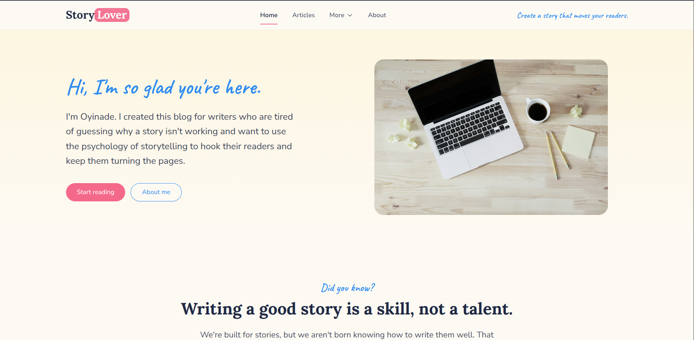
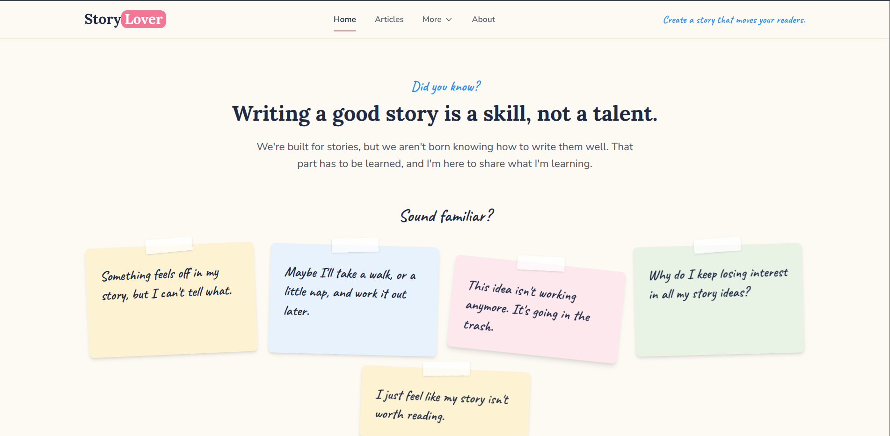
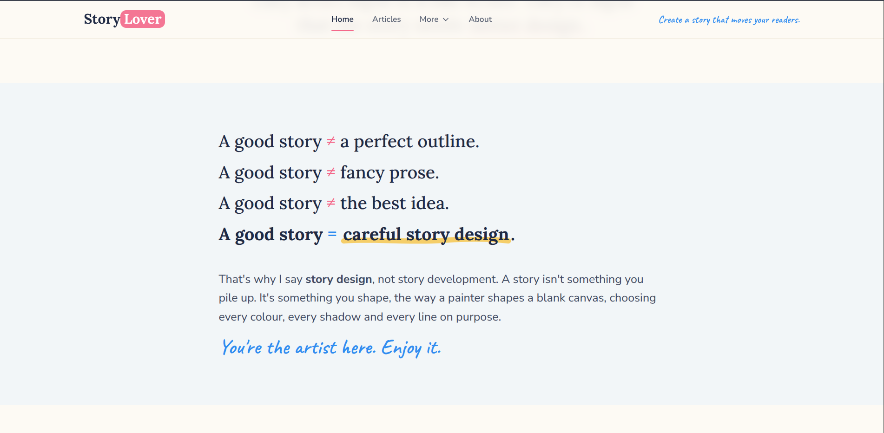

# StoryLover

An ongoing personal blog for writers who love stories. It shares the tricks of storytelling and the psychology behind it, to help writers build the right mindset for creating stories that move readers.

**Live site:** [add link]

## What It Does

**For readers**
- Browse published posts with search, category filters, and pagination
- Read posts with related-post suggestions
- Subscribe by email to get the weekly post and StoryLover updates
- Try the Story Clarity Checker, a guided questionnaire with a downloadable PDF summary
- Use the site on any screen size, since it is fully responsive

**For the admin**
- Log in securely, then create, edit, publish, and delete posts
- Upload images and videos for posts
- View and manage subscribers

Only the admin can post, edit, or delete content. Visitors can read and subscribe.

## Tech Stack

- **React 19** with **Vite**
- **Tailwind CSS** and **shadcn/ui** for styling and components
- **Supabase** for the database, authentication, and file storage
- **React Router** for navigation

## Running Locally

This project needs a Supabase project with its own database setup, so it isn't a one-command install. To see it in action, visit the live site above.

## Roadmap

- [ ] Comment section
- [ ] Schedule posts
- [ ] Pin posts
- [ ] Archive posts
- [ ] Redesign the website

## What I Learned

- How to use Supabase as the backend, with its database, authentication, and storage, instead of building and hosting a separate server
- How to write website copy that speaks to my audience and sounds like me, so the site connects with writers